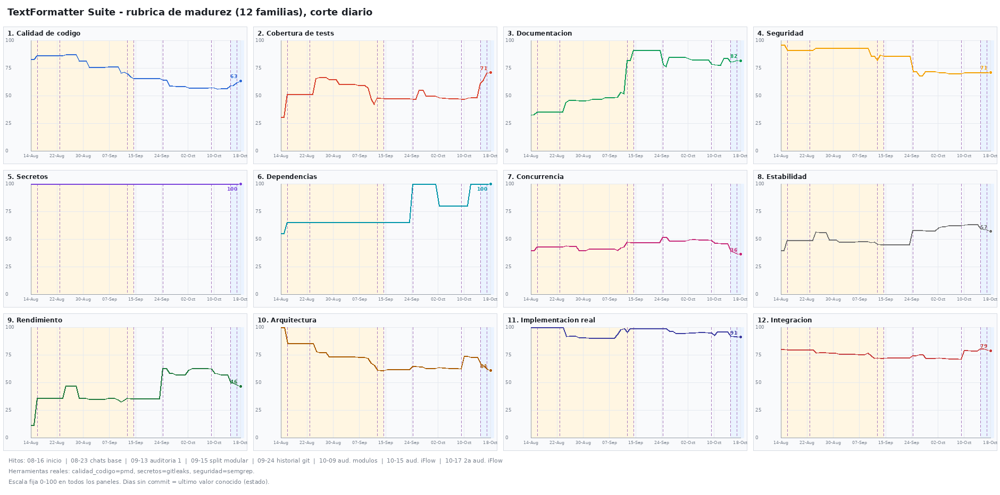
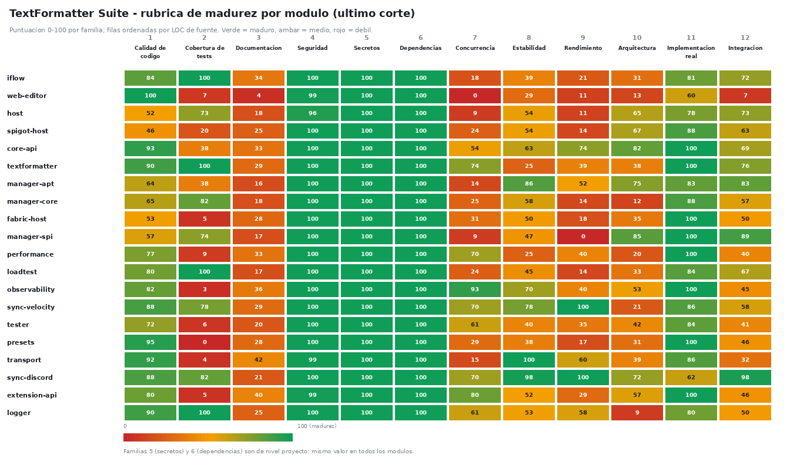
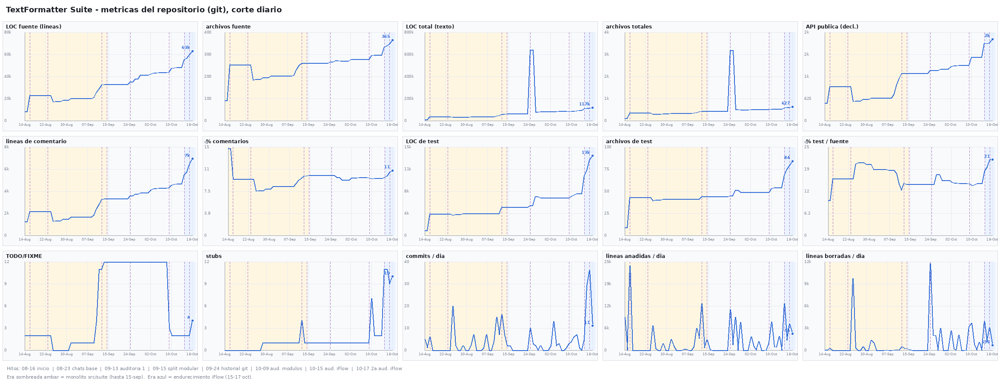
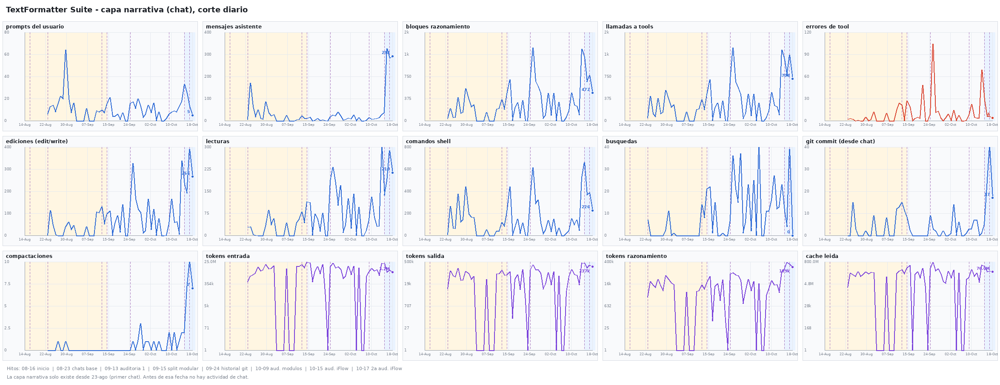
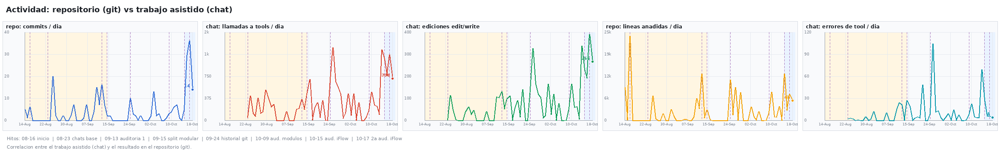
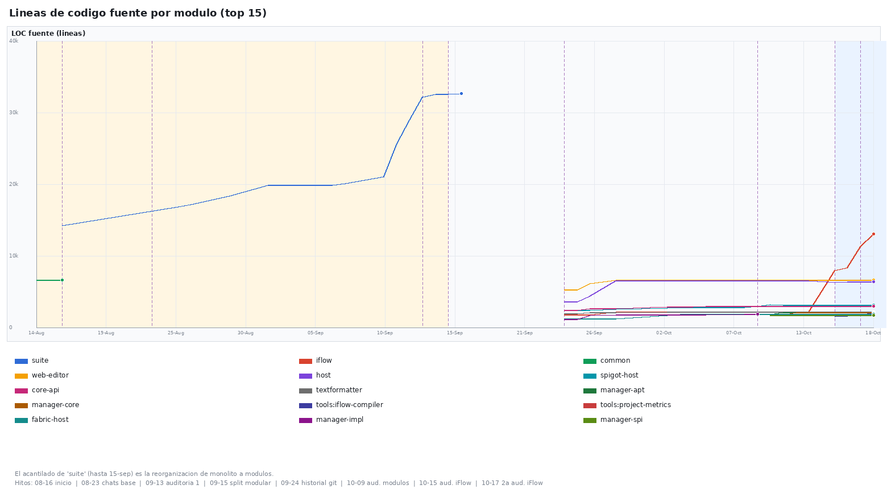
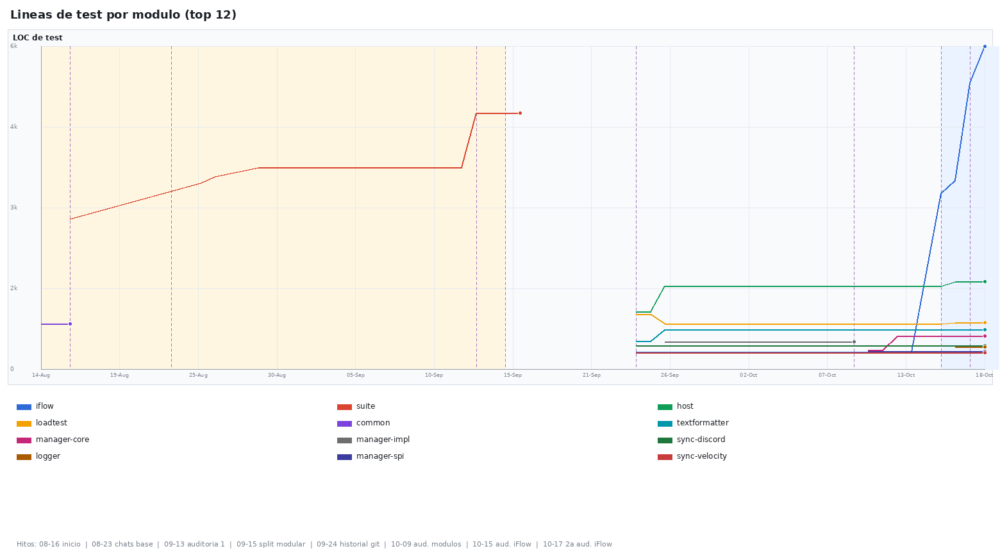
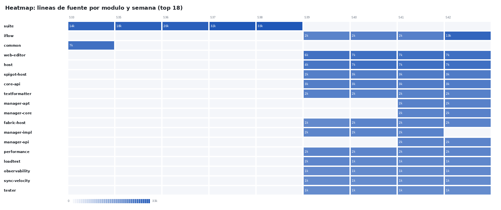
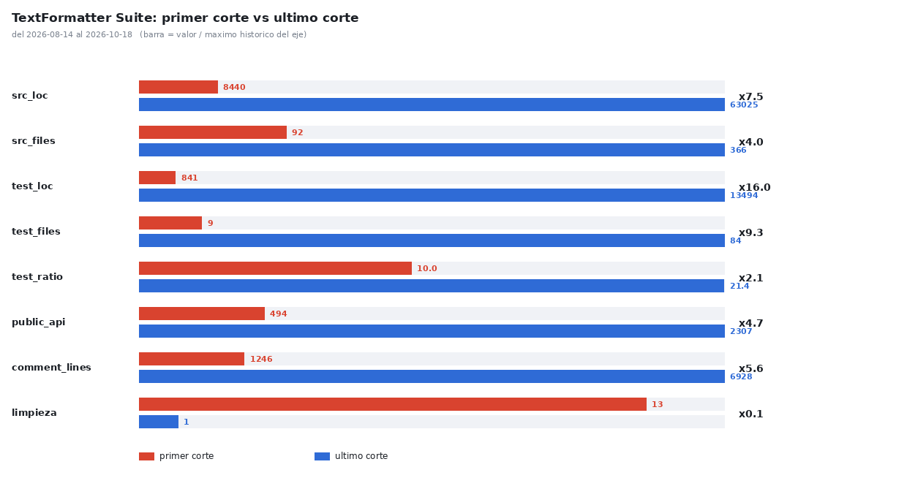

# TextFormatter Suite

> **Actualmente en desarrollo intenso — No apto para producción**
>
> Este proyecto evoluciona activamente. Las APIs, funcionalidades, configuraciones y mecanismos internos pueden cambiar sin aviso previo. No hay garantías de estabilidad, compatibilidad hacia atrás ni soporte para entornos de producción. La documentación refleja el estado real del código y las pruebas a fecha de hoy, no el estado ideal al que aspira el proyecto.

---

## Qué es TextFormatter Suite

TextFormatter Suite es una **plataforma modular de formateo, traducción y routing de chat para servidores Minecraft**, construida sobre una arquitectura hexagonal (ports & adapters) real. Reemplaza al proyecto monolítico anterior **ChatTranslator** reorganizando sus capacidades en 31 módulos Gradle que se comunican a través de contratos SPI (ServiceLoader) definidos en `core-api`.

**Problema que resuelve:** Los plugins de chat tradicionales mezclan formateo, traducción, permisos, sincronización cross-server y lógica de negocio en una única base de código acoplada a la plataforma (Bukkit/Fabric). TextFormatter Suite separa estas responsabilidades en módulos reemplazables, testeables en aislamiento y desplegables selectivamente.

**Enfoque:** Núcleo puro Java (JDK 17/21, cero dependencias externas) + adaptadores de plataforma delgados (`spigot-host`, `fabric-host`) que implementan los puertos del núcleo. Los módulos de funcionalidad (`textformatter`, `iflow-vm`, `iflow-wasm`, `iflow-firewall`, `gtranslate`, `ltranslate`, `sync-*`, `transport`, `observability`, `presets`, `manager-spi`, etc.) dependen de `core-api` y, cuando aplica, de contratos compartidos (`transport`, `messages`).

**Lo que NO es:**
- Un plugin único "todo en uno" listo para descargar y usar
- Una biblioteca estable con API versionada semánticamente publicada en Maven Central
- Un reemplazo directo de ChatTranslator v4 sin migración de configuración
- Un proyecto con releases oficiales, binarios publicados o garantías de soporte

---

## Estado de las funcionalidades (verificación honesta)

| Funcionalidad | Estado | Evidencia |
|---------------|--------|-----------|
| **Arquitectura hexagonal (core-api + SPI)** | ✅ Implementada y probada | `core-api` compila sin dependencias; los puntos de extensión usan ServiceLoader; tests de kernel/module loading pasan |
| **Motor de formateo MiniMessage (`textformatter`)** | ✅ Implementada y probada | `TemplateRenderer`, `MiniEscape` (10 chars), `ChannelRegistry`, `<tr>` tags; 32 tests |
| **Motor de reglas iFlow (VM)** | ✅ Implementada y probada | VM 16-bit flat 64KB + SoftMMU 4KB, bytecode `.flow` binario, `HOST` instruction, fuel budget 100K; 397 tests (VmInterpreter, HostServiceRegistry, VmPolicyEngine, FirmwareIntegrationTest) |
| **Traducción Google (gtranslate)** | ✅ Implementada y probada | Web scraping con UA rotation, rate limit, concatena todos segmentos; 17+19 tests extendidos |
| **Traducción LibreTranslate (ltranslate)** | ✅ Implementada y probada | Self-hosted/público, long-poll, tokens `char[]`; 17+15 tests extendidos |
| **Sync Discord** | ✅ Implementada y probada | Gateway v10 (WebSocket JDK + REST), intents, embeds; tokens `char[]`; 8 tests |
| **Sync Telegram** | ✅ Implementada y probada | Bot long-poll con watermark offset; tokens `char[]`; 7 tests |
| **Sync HTTP (webhook + REST)** | ✅ Implementada y probada | `HttpServer` JDK, inbound/outbound; 7 tests |
| **Sync TCP/UDP** | ✅ Implementada y probada | Raw sockets, JSON línea/datagrama, `MessageCodec`; 7 tests |
| **Sync WebSocket** | ✅ Implementada y probada | SO_REUSEADDR, auth token, subscripciones, log streaming; 1 test de contrato del módulo |
| **Sync Velocity (proxy)** | ✅ Implementada y probada | **Production-ready**: async queue, retry/backoff exponencial, métricas, health, dynamic discovery, mapping avanzado (regex, per-type); compila, tests pasan |
| **Sync Bus (pipeline unificado)** | ✅ Implementada y probada | `DefaultSyncBus`: deduplicación global, aislamiento por sink, retry/backoff, métricas; 4 tests de ciclo y entrega |
| **Spigot/Paper adapter (`spigot-host`)** | ✅ Implementada y probada | Plugin `TextFormatterSuite`: `AsyncPlayerChatEvent` (claim modes), join/quit/death/advancement channels, `/suite` commands, fat-jar shadow; **compila con Paper API 1.21.4**; probado en servidor real Paper 1.20.6 |
| **Fabric adapter (`fabric-host`)** | ⚠️ Compila (no probado en servidor real) | **COMPILA**: Fabric 1.21 + Fabric API 0.100.5, Brigadier, `ServerMessageEvents`, `ServerPlayConnectionEvents`, `ServerTickEvents`, death detection tick-based, claim mode configurable; **no probado en servidor real** |
| **Module Manager (runtime)** | ⚠️ Núcleo completado, releases descartados | GitHub/local/HTTP downloader, version resolver (semver ranges + env compat), dependency resolver (module.yml), relocator (fixed), ClassLoader aislado parent-last, SHA256 obligatorio, `register()` SPI-only, `discoverAll()`/`discoverAvailableModules()`, manifest validation obligatoria; **decisión: no habrá GitHub Releases públicos** (ver `PLAN.md`) |
| **Observabilidad** | ✅ Implementada y probada | `/metrics` (Prometheus), `/debug/*` (auth token, 127.0.0.1), Health checks (JVM, threads, sinks); 6 tests |
| **Presets** | ✅ Catálogo probado | Standard/RPG/Staff/Minimal, import/export YAML; 2 tests; sin motor de ejecución (placeholder) |
| **In-world (signs, chests, books)** | ✅ Compila y con test de contrato | WORLD/RADIUS, botones click/hover, caché + glosario; **compila con Paper API 1.21.4**, 1 test de descriptor, no probado en servidor |
| **Extensiones (SDK)** | ✅ Implementada y probada | `Extension`, `ExtensionContext`, `ExtensionManager`, Capability system, example-extension; 9 tests |
| **Web Editor** | ⚠️ Funcional con deuda visual/funcional | 108 tests unitarios + harnesses integración (StateStore, model, validate, canvas, preview, import/export ZIP, i18n EN/ES, undo/redo, docking); `npm run check` verde, pero la UI **no se considera estable** |
| **Config schema v2.2 (single-source)** | ✅ Sincronizado | `ConfigPath` enum → `paths.json`/`js/paths.js`/`js/model.js` via `ConfigSchemaGenerator`; `verifySchema` en CI (56 paths) |
| **Dependency Verification** | ✅ Activa con excepción documentada | 32 lockfiles (root + 31 subproyectos), `verification-metadata.xml` con 626 componentes, `checkLocks` bloqueante; los classpaths de `fabric-host` quedan fuera porque Loom remapea artefactos localmente |
| **Security Sprint 3** | ⚠️ P0 corregidos, P1 pendiente | Tokens `char[]`, MiniEscape 10 chars, PAPI dynamic check, SSRF (`getAllByName` + rechazo de `userinfo`), `SafeConstructor` en 6 cargas YAML, path traversal APT y límites de recursos; SpEL aislado en `iflow-firewall` con sandbox (ADR-001) |
| **Tests E2E pipeline completo** | ❌ Pendiente | Chat → iFlow → format → delivery en servidor real; 12 tests E2E unitarios existen pero requieren servidor real para validación completa |
| **GitHub Releases / publicación** | ❌ Denegado por decisión | No se publicarán releases ni tags mientras el proyecto siga en desarrollo; distribución vía source/build local. Ver [`docs/workdir/PLAN.md`](docs/workdir/PLAN.md) |
| **gradle.lockfile portable** | ⚠️ Parcial | Lockfiles existen pero reproducibilidad cross-platform no verificada exhaustivamente |

**Criterio usado:** "Implementada y probada" = código integrado + tests automatizados pasando (unit + integración donde aplica). "Compila" = build exitoso, sin tests de integración en entorno real. "Pendiente" = identificado en plan/docs pero sin implementación verificable.

---

## Métricas del proyecto (evolución real)

El repositorio **se mide a sí mismo**. [`tools/project-metrics/`](tools/project-metrics/README.md)
genera ~30 métricas a lo largo del tiempo —cortes diarios, no por commit— cruzando
el histórico de git con la narrativa de las sesiones de chat, más una **rúbrica de
madurez de 12 familias** (0–100). El renderizado es PNG estático (Pillow) y todo se
reproduce en local desde el código:

```bash
cd tools/project-metrics && ./run_all.sh   # regenera las 9 imágenes de docs/metrics/
```

Las gráficas de abajo corresponden al último corte medido (**2026-10-18**: 35 cortes
con commit sobre 66 días naturales). Métricas, filtros, rúbrica y juez, en
[`tools/project-metrics/README.md`](tools/project-metrics/README.md).

### Rúbrica de madurez (12 familias)



*Un panel por familia, en corte diario y con escala fija 0–100. Los días sin commit
arrastran el último valor conocido (la madurez es un estado, no actividad). Las
familias de **documentación** e **implementación real** llevan veredicto cualitativo,
producido por el agente de OpenCode mediante el skill
[`juzgar-rubrica`](.opencode/skills/juzgar-rubrica/SKILL.md); el resto son proxies
deterministas.*



*Matriz módulo × familia en el último corte. La fila `TOTAL (proyecto)` es la única
que lleva el veredicto cualitativo.*

### Actividad: repositorio y conversación



*15 métricas del repositorio: commits, líneas, LOC, tests, API pública, deuda.*



*15 métricas de la narrativa: mensajes, razonamiento, llamadas a herramientas, tokens.*



*Cruce de las dos capas: qué parte del código viene de trabajo conversado.*

> Los paneles marcan 8 **hitos** (inicio, chats base, auditorías, split modular…) y
> sombrean dos **eras**: el monolito `src/suite` y el endurecimiento de iFlow.

### Código por módulo



*LOC de fuente por módulo (top 15) a lo largo del tiempo. El acantilado de `suite`
hasta el 15-sep es la reorganización de monolito a módulos.*



*LOC de test por módulo (top 12): qué módulos tienen pruebas propias.*



*LOC por módulo y semana.*



*Primer corte (2026-08-14) frente al último (2026-10-18), con factor de crecimiento por
eje. En la fila `deuda (todo+stubs)` menos es mejor.*

---

## Enfoque, alcance y objetivos

| Objetivo | Descripción |
|----------|-------------|
| **Separación real de responsabilidades** | Cada capacidad (formateo, routing, traducción, sync, observabilidad) es un módulo independiente con contrato SPI propio |
| **Independencia de plataforma** | `core-api` y módulos funcionales son JDK-puro; solo `spigot-host`/`fabric-host` dependen de APIs de Minecraft |
| **Extensibilidad sin fork** | Nuevos proveedores de traducción, sinks de sync, formateadores, reglas = implementar SPI + registrar en META-INF/services |
| **Testabilidad** | Núcleo testeable sin servidor Minecraft; tests de integración con mocks; 766 tests JVM en 28 módulos y 108 tests JS (verificación local 2026-10-20) |
| **Seguridad por defecto** | Tokens en `char[]`, MiniEscape completo, sin motor de expresiones inline, SSRF protection, SafeConstructor YAML |
| **Reproducibilidad** | Gradle lockfiles + verification metadata para supply chain integrity |

**Fuera de alcance (explícitamente):**
- Base de datos / persistencia propia (usa YAML files + Module Manager para módulos)
- UI de administración en juego más allá de `/suite` commands
- Soporte para versiones antiguas de Minecraft (< 1.20.6 Spigot, < 1.21 Fabric)
- Garantías de compatibilidad binaria entre versiones SNAPSHOT
- Panel de control web / dashboard (solo web-editor de configuración estático)

---

## Catálogo de módulos (31 módulos Gradle)

### Núcleo y contratos
| Módulo | Propósito | Estado |
|--------|-----------|--------|
| `core-api` | Contratos SPI + modelo de dominio (`Module`, `Message`, `TranslationService`, `SyncSink`, `ActorDirectory`, `TranslatorProvider`, semver, capabilities) | ✅ Probado |
| `kernel` | Module loading, dependency graph (Tarjan), SPI resolution, `Environment` | ✅ Probado (13 tests) |
| `logger` | Logger centralizado (niveles, flags DEBUG, integración con `PluginLogger`) | ✅ Probado (20 tests) |
| `host` | Composition root: `SuiteBootstrap`, `SuiteHost`, `MessageDispatcher`, `ConfigLoader` (enum `ConfigPath`), `ConfigValidator` | ✅ Probado |
| `messages` | i18n centralizado EN/ES, `MessagesCatalog` singleton | ✅ Probado (5 tests) |

### Formateo y routing
| Módulo | Propósito | Estado |
|--------|-----------|--------|
| `textformatter` | MiniMessage engine, `TemplateRenderer`, `ChannelRegistry`, `<tr>` translation, `MiniEscape` | ✅ Probado (32 tests) |
| `iflow-vm` | VM 16-bit flat 64KB + SoftMMU 4KB, bytecode `.flow` binario, `HOST` instruction, fuel budget 100K, `VmPolicyEngine`, `VmInterpreter`, `SoftMMU`; base de la VM de 32 bits | ✅ Probado (397 tests) |
| `iflow-firewall` | Motor de reglas SpEL legacy restaurado (`DefaultRouter`, `RuleExpressionEvaluator`, `Rule`, `TransformOp`) + validador del grafo del editor; alternativa **mutuamente excluyente** de `iflow-vm` (mismo paquete base, solo uno instalado) | ✅ Probado (44 tests) |
| `iflow-wasm` | Motor WebAssembly (`.wasm`) con Chicory; W2: contrato, validación, instancia e invocación; sin ABI de host ni integración | 🧪 W2 |
| `presets` | Presets predefinidos (standard, rpg, staff, minimal), import/export YAML; sin motor de ejecución | ✅ Catálogo probado (2 tests) |

### Traducción
| Módulo | Propósito | Estado |
|--------|-----------|--------|
| `gtranslate` | Google Translate provider (web scraping, UA rotation, rate limit, concatena segmentos) | ✅ Probado (17+19 tests) |
| `ltranslate` | LibreTranslate provider (self-hosted/público, long-poll, tokens `char[]`) | ✅ Probado (17+15 tests) |

### Transporte y sincronización
| Módulo | Propósito | Estado |
|--------|-----------|--------|
| `transport` | `Transport` abstraction, `HttpTransport` (`HttpURLConnection`), `MessageCodec`, SSRF protection (`getAllByName`, RFC 1918/3927/6598) | ✅ Probado |
| `sync-bus` | **Nuevo**: Pipeline unificado — deduplicación global, aislamiento por sink, retry/backoff, métricas, health | ✅ Probado (4 tests) |
| `sync-discord` | Discord Gateway v10 (WebSocket JDK + REST), intents, embeds, tokens `char[]` | ✅ Probado (8 tests) |
| `sync-telegram` | Telegram Bot long-poll, watermark offset, tokens `char[]` | ✅ Probado (7 tests) |
| `sync-http` | Webhook + REST (`HttpServer` JDK), inbound/outbound | ✅ Probado (7 tests) |
| `sync-tcpudp` | TCP/UDP raw sinks, JSON línea/datagrama | ✅ Probado (7 tests) |
| `sync-websocket` | WebSocket sync (SO_REUSEADDR, auth token, subs, log streaming) | ✅ Probado (1 test de contrato) |
| `sync-velocity` | Velocity proxy sink — **production-ready**: async queue, retry/backoff, métricas, health, dynamic discovery, mapping regex/per-type | ✅ Probado |

### Operación y extensibilidad
| Módulo | Propósito | Estado |
|--------|-----------|--------|
| `manager-spi` | SPI del Module Manager: `ModuleCoordinate`, `ModuleDescriptor`, `Environment`, `ModuleLifecycle`, manifiestos y versiones | ✅ Probado |
| `manager-core` | Instalador de paquetes ZIP, base de datos local y transaction log | ✅ Probado (19 tests) |
| `manager-apt` | Repositorios, resolución de dependencias y fachada APT/dpkg | ⚠️ Núcleo probado (13 tests) |
| `extension-api` | Extension SPI: `Extension`, `ExtensionContext`, `ExtensionManager`, Capability system | ✅ Probado (6 tests) |
| `example-extension` | Demo de extensión funcional | ✅ Probado (3 tests) |
| `observability` | `/metrics` (Prometheus), `/debug/*` (auth, 127.0.0.1), Health checks (JVM, threads, sinks) | ✅ Probado (6 tests) |
| `inworld` | Signs, chests, books (WORLD/RADIUS), click/hover, caché + glosario | ✅ Probado (1 test de contrato) |
| `performance` | `PerformanceProfiler`, `HotspotDetector`, `CacheOptimizer`, `MemoryOptimizer` | ✅ Probado (7 tests) |
| `loadtest` | JMH benchmarks + Gatling | ✅ Compila |
| `tester` | 25 tests runtime automatizados (`/suite test full|stress|concurrency`), `PerformanceProfiler` | ✅ Probado |

### Adaptadores de plataforma
| Módulo | Propósito | Estado |
|--------|-----------|--------|
| `spigot-host` | Plugin Bukkit/Paper (`TextFormatterSuitePlugin`): `SpigotActorDirectory`, `SpigotChatDelivery`, bootstrap, `/suite` commands, fat-jar shadow | ✅ Probado en servidor real Paper 1.20.6 |
| `fabric-host` | Mod Fabric (`TextFormatterSuiteMod`): `FabricActorDirectory`, `FabricChatDelivery`, Brigadier, Fabric events, death detection tick-based | ⚠️ Compila (sin tests Java; verificación Loom local; no probado en servidor real) |

### Legacy / referencial
| Módulo | Propósito | Estado |
|--------|-----------|--------|
| `common-legacy` | Referencia histórica del trío monolítico eliminado | 📚 Solo referencia (0 fuentes Java) |

> **Documentación por módulo:** Cada módulo en `src/*/README.md` detalla responsabilidades, dependencias, data flow y entry points. Ver [`src/README.md`](src/README.md) para mapa completo y discrepancias conocidas.

---

## Instalación y primeros pasos

### ⚠️ No hay releases oficiales ni binarios publicados
El proyecto **no publica JARs en Maven Central, GitHub Releases ni ningún repositorio de artefactos**. La única forma verificada de obtener el plugin/mod es **compilar desde fuente**. Esta no es una limitación temporal: la publicación de releases está **descartada por decisión del proyecto** mientras siga en desarrollo; ver [`docs/workdir/PLAN.md`](docs/workdir/PLAN.md).

### Requisitos previos
- **JDK 17 y 21** (toolchain Gradle; bytecode target 17)
- **Gradle 8.13** (wrapper incluido)
- **Git**
- Servidor Minecraft para probar:
  - **Spigot/Paper**: 1.20.6+ (probado en Paper 1.20.6 real)
  - **Fabric**: 1.21 + Fabric Loader 0.16+ + Fabric API 0.100.5 (compila, no probado en servidor real)

### Compilar desde fuente (verificado)

```bash
# Clonar
git clone https://github.com/majhrs16-official/TextFormatter-Suite.git
cd TextFormatter-Suite

# Configurar JDKs (ajustar rutas a tu entorno)
export JAVA_HOME=/opt/javac/x64/21
# En gradle.properties declarar org.gradle.java.installations.paths para JDK 17 y 21

# Compilar suite completa (tests + build)
./gradlew buildAll checkLocks --no-daemon

# Generar Javadoc
./gradlew javadocAll --no-daemon

# Plugin Spigot (fat-jar en src/spigot-host/build/libs/)
./gradlew :src:spigot-host:build --no-daemon

# Mod Fabric (en src/fabric-host/build/libs/)
./gradlew :src:fabric-host:build --no-daemon

# Web Editor (validación + tests)
cd src/web-editor
npm ci
npm run check          # format:check + lint + test (108 unit)
npm run test:integration
```

> **Estado del editor web:** la suite de tests JS pasa, pero la UI tiene deuda funcional y visual conocida; no se considera estable ni se usa como fuente de verdad de la configuración. El YAML y los tests son la referencia.

### Instalar en servidor (tras compilar)

**Spigot/Paper:**
```bash
cp src/spigot-host/build/libs/textformatter-suite-spigot-*.jar /ruta/servidor/plugins/
# Iniciar servidor → se genera config en plugins/TextFormatterSuite/
# Editar plugins/TextFormatterSuite/config.yml
# /suite reload
```

**Fabric:**
```bash
cp src/fabric-host/build/libs/textformatter-suite-fabric-*.jar /ruta/servidor/mods/
# Requiere Fabric Loader + Fabric API 0.100.5 en mods/
# Iniciar servidor → se genera config en config/textformattersuite/
# Editar config/textformattersuite/config.yml
# /suite reload
```

### Verificar carga correcta
- Comando `/suite` muestra status
- `/suite status` lista canales, traductor activo, knobs
- Logs muestran `[TextFormatterSuite] Loaded X modules` y sinks registrados

### Limitaciones conocidas antes de probar
- **Fabric**: No probado en servidor real; death detection usa tick-based polling
- **Module Manager**: No hay releases públicos; `discoverAvailableModules()` requiere repo local/HTTP configurado
- **Config**: Schema v2.2 tiene copias manuales (`paths.json`, `schema-v2.2.md`) no centralizadas
- **Sin migración automática** desde ChatTranslator v4 o configs legacy

---

## Desarrollo: IDE y terminal

### IntelliJ IDEA (verificado)
1. **File → Open** → seleccionar carpeta raíz del repo (`TextFormatter-Suite/`)
2. **Import as Gradle Project** → usar wrapper (`./gradlew`)
3. **JDK**: seleccionar JDK 21 para el proyecto (toolchain resuelve 17 para bytecode)
4. **Gradle Sync** → espera resolución de dependencias (primera vez descarga ~200MB)
5. **Módulos**: 31 subproyectos bajo `:src` aparecen en panel Gradle
6. **Tasks útiles**:
   - `:src:core-api:test` — tests núcleo
   - `:src:spigot-host:build` — fat-jar plugin
   - `:src:fabric-host:build` — mod fabric
   - `checkLocks` — audita lockfiles
   - `javadoc` — genera docs

### Visual Studio Code (verificado)
1. Extensiones recomendadas: **Extension Pack for Java** (Microsoft), **Gradle for Java** (Microsoft)
2. **File → Open Folder** → raíz del repo
3. **Java: Configure Java Runtime** → JDK 21
4. **Gradle: Reload All Projects** (Ctrl+Shift+P → "Gradle: Reload")
5. Terminal integrado: `./gradlew tasks` lista tareas disponibles

### Terminal sin IDE (verificado)
```bash
# Compilar todo
export JAVA_HOME=/opt/javac/x64/21
./gradlew build --no-daemon

# Tests solo módulo específico
./gradlew :src:iflow-vm:test --no-daemon
./gradlew :src:iflow-wasm:test --no-daemon

# Tests suite completa
./gradlew test --no-daemon

# Lockfiles + verification
./gradlew checkLocks --no-daemon

# Javadoc
./gradlew javadocAll --no-daemon

# Web editor
cd src/web-editor && npm run check
```

> **Nota:** Con caché Gradle poblada, todo compila `--offline`. La primera build descarga dependencias (~2-5 min).

---

## Compilación y verificación

| Objetivo | Comando | Notas |
|----------|---------|-------|
| Build completo + tests | `./gradlew buildAll --no-daemon` | Incluye tests de todos los subproyectos |
| Solo tests de un módulo | `./gradlew :src:<modulo>:test --no-daemon` | 766 tests JVM en 28 módulos y 108 tests JS (verificación local 2026-10-20) |
| Solo build (sin tests) | `./gradlew build -x test --no-daemon` | Solo el proyecto raíz |
| Plugin Spigot (fat-jar) | `./gradlew :src:spigot-host:build --no-daemon` | En `src/spigot-host/build/libs/` |
| Mod Fabric | `./gradlew :src:fabric-host:build --no-daemon` | En `src/fabric-host/build/libs/` |
| Javadoc | `./gradlew javadocAll --no-daemon` | En `**/build/docs/javadoc/` |
| Lockfiles auditoría | `./gradlew checkLocks --no-daemon` | 32 lockfiles, 0 missing; falla si falta alguno |
| Verificación dependencias | `gradle/verification-metadata.xml` + `--dependency-verification=strict` en CI | Activa; 626 componentes; excepción documentada solo para los classpaths de `fabric-host` (artefactos remapeados por Loom) |
| Web editor check | `cd src/web-editor && npm run check` | Format + lint + tests unitarios |
| Web editor tests integración | `cd src/web-editor && npm run test:integration` | Harnesses func/interact/click/chain/undo/diffing/bind |
| **Build reproducible (release)** | `BUILD_TIMESTAMP=1728000000000 ./gradlew build -Pversion=2.1.0` | JAR con `Build-Timestamp` fijo |
| **Verificar Build-Timestamp** | `unzip -p artifact.jar META-INF/MANIFEST.MF \| grep Build-Timestamp` | Debe coincidir con timestamp fijado |

---

## Cómo contribuir

La política de contribución está en [`CONTRIBUTING.md`](CONTRIBUTING.md); el trato esperado, en [`CODE_OF_CONDUCT.md`](CODE_OF_CONDUCT.md). Para vulnerabilidades, usa [`SECURITY.md`](SECURITY.md) y **no abras un issue público**.

Resumen del flujo:

1. **Investigar**: Lee [`src/README.md`](src/README.md) para entender arquitectura, [`docs/workdir/PLAN.md`](docs/workdir/PLAN.md) para roadmap, [`docs/workdir/ADR.md`](docs/workdir/ADR.md) para decisiones previas
2. **Localizar módulo**: Usa el catálogo arriba o `src/README.md` §3 para encontrar el módulo responsable
3. **Tests primero**: Añade test unitario/integración que falle antes de fix; ejecuta `./gradlew :src:<modulo>:test`
4. **Verifica**: `./gradlew buildAll --no-daemon` + `./gradlew checkLocks --no-daemon` + `cd src/web-editor && npm run check && npm run test:integration`
5. **Commits atómicos**: Un cambio lógico por commit; mensaje convencional (`fix:`, `feat:`, `docs:`, `refactor:`)
6. **No rompas contratos**: `core-api` es inmutable para consumidores; cambios requieren ADR
7. **Documenta**: Actualiza `src/<modulo>/README.md` y `docs/workdir/PLAN.md` si cambia estado/funcionalidad
8. **PR**: Abre Pull Request contra `main`; el CI está configurado para build + tests + lockfiles + schema + javadoc + web-editor. No crees tags ni ejecutes el release: la publicación está descartada.

El historial de cambios está en [`CHANGELOG.md`](CHANGELOG.md).

---

## Convenciones de desarrollo (observadas en el repo)

| Área | Convención |
|------|------------|
| **Organización módulos** | `src/<modulo>/` con `build.gradle` propio; composite build vía `settings.gradle` |
| **Separación responsabilidades** | `core-api` = contratos (JDK-puro); módulos funcionales dependen solo de `core-api`; adapters dependen de suite + 1 SDK plataforma |
| **Naming** | Paquetes `me.majhrs16.suite.<modulo>`; interfaces SPI en `...api.spi.*`; implementaciones en módulo correspondiente |
| **SPI / ServiceLoader** | Todos los puntos de extensión usan `META-INF/services/<interface>`; `core-api` define interfaces, módulos implementan |
| **Gestión dependencias** | `implementation project(':src:...')` para módulos internos; `compileOnly` para APIs plataforma (Paper, Fabric); `testImplementation` para tests |
| **Compatibilidad plataformas** | Código compartido en `core-api`/`host`/módulos funcionales; adaptadores en `spigot-host`/`fabric-host` implementan `ActorDirectory`, `ChatDelivery`, `PlaceholderResolver` |
| **Tests** | JUnit 5; tests unitarios en `src/test/java`; tests integración donde aplica; `ModuleLoaderTest` requiere aislamiento classpath |
| **Documentación APIs** | Javadoc en código; module READMEs en `src/<modulo>/README.md`; ADR en `docs/workdir/ADR.md` para decisiones arquitectónicas |
| **Errores** | Excepciones checked para errores recuperables; `IllegalStateException`/`SecurityException` para violaciones de contrato; logging SLF4J vía `PluginLogger` SPI |
| **Configuración** | YAML con snakeyaml `SafeConstructor`; `ConfigLoader` (enum `ConfigPath`) + `ConfigValidator`; defaults en `resources/defaults/` copiados en primer arranque |
| **Nuevas funcionalidades** | 1) Definir SPI en `core-api` si es punto de extensión; 2) Implementar en módulo dedicado; 3) Registrar vía ServiceLoader; 4) Wiring en `host`/`spigot-host`/`fabric-host`; 5) Tests + docs |

---

## Organización de la documentación

| Documento | Responsabilidad | Enlace |
|-----------|-----------------|--------|
| **README.md** (este archivo) | Página principal: presentación, estado, instalación, contribución, enlaces | — |
| **src/README.md** | Índice técnico: mapa módulos, dependencias, entry points, flows, discrepancias | [`src/README.md`](src/README.md) |
| **docs/workdir/PLAN.md** | Plan vivo: fases, estado actual, próxima acción, deuda conocida | [`docs/workdir/PLAN.md`](docs/workdir/PLAN.md) |
| **docs/workdir/ADR.md** | Architecture Decision Records: decisiones inmutables con contexto/fecha/consecuencias | [`docs/workdir/ADR.md`](docs/workdir/ADR.md) |
| **docs/wiki/01-Introduction.md** | Entrada wiki usuario/dev: quick start, módulos, arquitectura, guías | [`docs/wiki/01-Introduction.md`](docs/wiki/01-Introduction.md) |
| **docs/wiki/02-Configuration.md** | Guía configuración (config.yml, channels, rules, translators, sync) | [`docs/wiki/02-Configuration.md`](docs/wiki/02-Configuration.md) |
| **docs/wiki/05-iFlow-Rules.md** | ⚠️ Legacy: describe el motor de reglas antiguo (`DefaultRouter`, SpEL), restaurado en `iflow-firewall` y seleccionable con `iflow.engine.kind: firewall`. La VM `.flow` y Wasm no usan SpEL | [`docs/wiki/05-iFlow-Rules.md`](docs/wiki/05-iFlow-Rules.md) |
| **docs/wiki/08-Commands.md** | Referencia comandos `/suite` (dinámicos v2) | [`docs/wiki/08-Commands.md`](docs/wiki/08-Commands.md) |
| **docs/wiki/10-Module-Manager.md** | Module Manager runtime: install/update/remove/info, repos, firmas | [`docs/wiki/10-Module-Manager.md`](docs/wiki/10-Module-Manager.md) |
| **docs/prompts/** | Material de referencia: contexto del proyecto, diseños de componentes y contratos de formato | [`docs/prompts/README.md`](docs/prompts/README.md) |
| **.opencode/skills/** | Procedimientos que el agente ejecuta por sí mismo (auditar, generar documentación) | [`docs/prompts/README.md`](docs/prompts/README.md) § Prompt frente a skill |
| **docs/prompts/diseno/iflow-cpu-implement.md** | Especificación técnica de referencia v3 de iFlow VM (32 bits), derivada de la auditoría manual 2026-10-20 (41 hallazgos `IFLOW-MAN-01..41` + 9 arquitecturales `IFLOW-MAN-46..54`: capas BIOS/kernel/router, `ExecutionContext` mutable, `MessageHostContext` acoplado, sin kernel/scheduler, `VmBus` subutilizado, `machineLock` global, mensaje como IRQ, multi-núcleo 32 bits; 4 diferidos `IFLOW-MAN-42..45`: idioma de render, `Formats` multi-entrada, redirect y `Direction.channel`; fallback neutral, little-endian único, decode jerárquico `MOV`, máquina persistente sin fuel, rate limit como política de userspace, routing tipado, contador de ciclos y journal limitado al mensaje; arquitectura ROM/BIOS/kernel/32 bits) | [`docs/prompts/diseno/iflow-cpu-implement.md`](docs/prompts/diseno/iflow-cpu-implement.md) |
| **tools/project-metrics/README.md** | Herramienta de métricas: ~30 métricas diarias, rúbrica de 12 familias, juez cualitativo | [`tools/project-metrics/README.md`](tools/project-metrics/README.md) |
| **src/<modulo>/README.md** | Codeguide por módulo: responsabilidades, deps, data flow, entry points | Ver [`src/README.md`](src/README.md) §3 |

> **Criterio de carpetas:** `docs/workdir/` guarda documentos de trabajo y `docs/prompts/` material de referencia (fuentes de verdad que se consultan). Los procedimientos —auditar, generar documentación— no son prompts: son skills en `.opencode/skills/`, y el criterio completo está en [`docs/prompts/README.md`](docs/prompts/README.md). Un prompt ya implementado que no se vaya a reutilizar se elimina; no se mantiene como histórico.

---

## Validación realizada

- [x] Advertencia "Actualmente en desarrollo intenso — No apto para producción" visible al inicio
- [x] Funcionalidades clasificadas con estados honestos y evidencia (tests, build, probado en servidor)
- [x] Propósito, enfoque, objetivos y límites explicados sin promesas futuras
- [x] Catálogo de 31 módulos reales agrupados por responsabilidad con estado
- [x] Instalación distingue: uso plugin (requiere build previo) vs desarrollo vs tests
- [x] IDE (IntelliJ, VS Code) y terminal documentados con comandos verificables
- [x] Comandos build/test/verificación contrastados contra `settings.gradle`/`build.gradle` y tareas reales
- [x] Contribución: flujo conservador sin inventar políticas inexistentes
- [x] `src/README.md` conserva su responsabilidad de mapa técnico y se enlaza
- [x] Documentación técnica extensa en archivos especializados (wiki, ADR, module READMEs)
- [x] Enlaces internos válidos y rutas relativas correctas desde GitHub
- [x] No se han inventado capacidades, releases, comandos ni requisitos
- [x] Verificación local: `buildAll` completo, `javadocAll`, `checkLocks` (32/32), `:src:host:verifySchema`, 766 tests JVM en 28 módulos (0 fallos, 11 skipped) y 108 tests JS; el run #65 detectó metadata de verificación incompleta en un checkout limpio, se corrigió y el run #66 sobre `acd7b25` completó los cuatro jobs en verde

---

## Licencia

GPL-3.0 — Ver [`LICENSE`](LICENSE) (si existe en el repo) o cabecera de archivos fuente.

---

*Última actualización: 2026-10-27 — `iflow-firewall` restaura el motor SpEL legacy (ADR-001) como alternativa **mutuamente excluyente** de `iflow-vm`; el host selecciona el motor instalado con `iflow.engine.kind`. Antes: P0 de código, limpieza material, aislamiento de SpEL, lockfiles, schema, workflows, documentación de comunidad, Javadoc agregado y tests de contrato de 9 módulos remediados. El release está descartado por decisión del proyecto. El primer run de CI (#65) reveló metadata de verificación incompleta para un checkout limpio; la corrección se publicó y el run #66 completó los cuatro jobs en verde. Queda deuda P1 (editor web inestable, documentación histórica y pruebas de plataforma).*